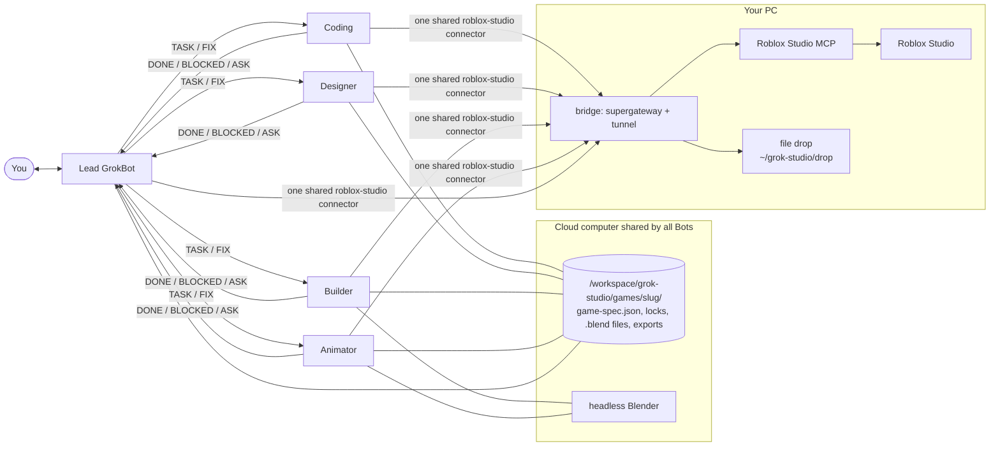

# grok-studio

**An agentic Roblox studio inside Grok Bot.** Install the plugin, run one setup command,
and you get a team of five Grok Bots that build a complete Roblox game in *your* Roblox
Studio from one prompt:

| Bot | Does |
|---|---|
| **Lead GrokBot** | talks to you, writes the game spec, plans and hands out tasks, runs playtests, final gate |
| **Coding GrokBot** | all Luau: server services, remotes with validation, DataStores, client controllers |
| **Designer GrokBot** | UI (HUD, menus, shops) in Studio, optional Figma, icon and thumbnails |
| **Builder GrokBot** | the world and every 3D model, in Studio (parts, procedural and generated models) and in Blender |
| **Animator GrokBot** | rigs and animations (Luau keyframes in Studio, or Blender) |

The Bots message each other directly, work in parallel, and share one cloud computer and
one `game-spec.json`. They follow a team protocol, so five agents in one Studio don't
break each other's work.

Also works in **Claude Code / Grok Build / Cursor**: the same roles ship as subagents in
`agents/`, and the main session plays the Lead.

> Status: **v0.2.0, early.** The bridge was run end to end against a live Studio on
> Windows. The multi-bot flow has not yet done a full build. See [Limitations](#limitations).

---

## Run it on Grok Bot

**On your PC (once):** Roblox Studio open with a place, and **Assistant > ... > Manage MCP
Servers > Enable Studio as MCP server** turned on. In Grok Bot, **Settings > General > Bot >
Execution on Local Computer** = *Ask every time*, so the Lead can start the bridge on your
PC with your approval.

**In Grok Bot:**
1. Install **grok-studio** from the plugin marketplace. Until it is listed, tell any Bot:
   *"Install the grok-studio plugin from https://github.com/brain-xiang/grok-studio"* (branch
   `multi-bot-team` until it is merged). If
   it can't install unlisted plugins, ask it to clone the repo into
   `/workspace/grok-studio/plugin` and save every `skills/*/SKILL.md` there as a skill.
2. Type **`/setup-bridge`**. It sets up everything:
   - creates the five Bots in a **Grok Studio** sidebar section, with their instructions
   - installs headless Blender on the Bots' cloud computer (nothing to install on your PC)
   - starts the bridge on your PC and connects your Studio
     (approve its commands in that chat)
   - checks Figma (optional, one Authorize click) and an optional Roblox Open Cloud key
   - pings Studio from every Bot, shows a ready table, and hands your game idea to the Lead
3. Describe the game in the same chat (it goes to **Lead GrokBot**), or in Lead GrokBot:

> Make a co-op tycoon where players run a volcano-powered hot sauce factory. Conveyor
> droppers make sauce bottles, players collect cash, buy upgrades and unlock a second
> floor. Low-poly cartoon style, mobile-friendly UI, no monetization. Save progress.
> Make a thumbnail and icon.

**Next session:** run `/setup-bridge` again (it only reconnects Studio), or just ask the Lead to build: it
reconnects Studio itself. **Stop:** tell the Lead "disconnect Studio", or press Ctrl+C in
the bridge window. The bridge key dies with it.

## How it works



- **Studio** stays on your PC (it only runs on Windows/macOS). The bridge exposes it to
  the cloud Bots behind one authenticated URL with a fresh key per session. See
  [`bridge/README.md`](bridge/README.md).
- **Blender** runs headless on the cloud computer. Models reach Studio through an Open Cloud
  upload (automatic, if you add a key) or one **Import 3D** click per batch, with the file
  already dropped on your PC.
- **Team protocol** ([`skills/team-protocol`](skills/team-protocol/SKILL.md)):
  - every Bot writes only its own part of the place and of the spec
  - only the Lead plays the game (a `studio-play` lock, so nobody edits while play mode
    is on)
  - spec writes take a lock
  - one `.blend` file per asset
  - fixed `TASK` / `DONE` / `BLOCKED` / `ASK` / `FIX` message formats

## What's inside

```
.cursor-plugin/plugin.json   Cursor / Grok Bot plugin manifest
.claude-plugin/plugin.json   Claude Code plugin manifest
mcp.json, .mcp.json          MCP servers (local agents; Grok Bot uses the bridge)
agents/                      coder, designer, builder, animator (subagents + Grok Bot instructions)
skills/
  setup-bridge/              /setup-bridge: the one setup command - Studio, the Bots, Blender, Figma, smoke test (+ lead-bot.md)
  team-protocol/             workspace layout, ownership, locks, message formats
  grok-studio/               Lead playbook: preflight, spec, plan, dispatch, playtests, gate, handoff
  connect-studio/            starts/stops the bridge on the user's PC via ExternalShell, registers the connector
  game-spec/                 prompt -> game-spec.json (+ schema.json, example)
  roblox-code/               Luau architecture, remotes, DataStores, anti-exploit (+ reference/*.luau)
  roblox-ui/                 Studio-direct ScreenGui builder, Figma path (+ reference/UiKit.luau)
  roblox-building/           maps, terrain, lighting, tagged parts, Studio generation tools
  blender-assets/            headless cloud Blender, checkpoints, review renders, FBX export, upload
  roblox-animations/         R15 keyframes in Luau or Blender, ids, publishing
  playtest-loop/             play, simulate input, read logs, route fixes, report
  thumbnail-and-icon/        512x512 icon, 1920x1080 thumbnails
bridge/                      start-bridge.ps1 / .sh, files-server.mjs (file drop)
scripts/                     studio-mcp.mjs, send-to-pc.py, opencloud_upload.py, validate.py
rules/roblox-luau.mdc        Luau conventions (Cursor rule)
```

## Local agents (Claude Code, Cursor, Grok Build)

Studio on the same machine, no bridge needed.
- **Claude Code:** `claude --plugin-dir /path/to/grok-studio` (or a marketplace you
  control). It reads `.claude-plugin/plugin.json`, `skills/`, `agents/` and `.mcp.json`.
  Then: *"Use the grok-studio skill to build ..."*. The main session is the Lead, and
  `coder`/`designer`/`builder`/`animator` run as subagents.
- **Cursor:** copy the folder (not a symlink) into `~/.cursor/plugins/local/grok-studio`,
  then **Developer: Reload Window**.
- **Requirements:** Node.js LTS (`npx`), uv (`uvx`) for the local Blender MCP (optional),
  Blender with the MCP for Blender add-on (`uvx mcp-for-blender setup`, optional).
- **Avoid duplicate tools:** if Studio's *Quick connect* or `mcp-for-blender setup` already
  added `Roblox_Studio`/`blender` to your client, remove those entries or disable this
  plugin's copies.

## Connector setup reference

### 1. Roblox Studio MCP (required)
- Built into Studio; local **stdio** process. Official configs
  ([docs](https://create.roblox.com/docs/studio/mcp)):
  - Windows: `cmd.exe /c %LOCALAPPDATA%\Roblox\mcp.bat`
  - macOS: `/Applications/RobloxStudio.app/Contents/MacOS/StudioMCP`
- Tools used: `list_roblox_studios`, `script_read`, `multi_edit`, `script_search`,
  `script_grep`, `execute_luau`, `search_game_tree`, `inspect_instance`, `search_asset`,
  `insert_asset`, `generate_mesh`, `generate_material`, `generate_procedural_model`,
  `get_studio_state`, `start_stop_play`, `get_console_output`, `screen_capture`,
  `character_navigation`, `user_keyboard_input`, `user_mouse_input`, `subagent`, `skill`.
  Every call takes a `studio_id`.

**How this plugin handles the OS difference.** A plugin `mcp.json` can't be OS-conditional,
so instead of asking every user to configure a path, the `roblox-studio` entry runs
`node ${CURSOR_PLUGIN_ROOT}/scripts/studio-mcp.mjs` (Claude Code: `${CLAUDE_PLUGIN_ROOT}`).
The launcher picks the right binary per OS, passes stdio straight through, and writes
diagnostics to stderr only. Override with the environment variable
`ROBLOX_STUDIO_MCP_PATH` for non-standard installs. We deliberately did **not** use a
Cursor plugin variable (`${ROBLOX_STUDIO_MCP_COMMAND}`): variables are set by admins in the
dashboard (Plugins > Configure), would force every user to configure something, and the
docs don't promise substitution inside `command`. Zero-config wins.

### 2. Blender MCP (optional, recommended)
- `uvx mcp-for-blender` (PyPI package formerly `blender-mcp`; `uvx blender-mcp` still
  works) - [github.com/ahujasid/mcp-for-blender](https://github.com/ahujasid/mcp-for-blender).
- Add-on: `uvx mcp-for-blender setup` or `uvx mcp-for-blender install-addon`, then enable
  **Interface: MCP for Blender** in Preferences > Add-ons.
- This plugin sets `BLENDER_MCP_SAFE_MODE=1`: scripts that touch arbitrary files, the
  network, or spawn processes are blocked; modeling, materials, rendering, saving, and
  import/export still work.
- **Alternative:** Blender's official [Blender Lab MCP server](https://www.blender.org/lab/mcp-server/)
  (Blender 5.1+, add-on from the Blender Lab repository). Its tool set differs; the
  `blender-assets` skill is written against mcp-for-blender but the bpy code it sends is
  portable. Blender Lab warns that it runs LLM-generated code without guards.

### 3. Figma MCP (optional)
- Remote server `https://mcp.figma.com/mcp`, OAuth on first use
  ([docs](https://developers.figma.com/docs/figma-mcp-server/remote-server-installation/)).
- Canvas writes (`use_figma`) are documented for Professional, Education, Organization and
  Enterprise plans (beta, free during beta). Read tools are rate-limited: View/Collab seats
  up to 20 calls/month; Full/Dev seats on Professional up to 200/day
  ([rate limits](https://developers.figma.com/docs/figma-mcp-server/rate-limits-access/)).
  On a Starter plan, expect to use the Studio-direct UI path.
- Figma also ships its own Cursor/Claude plugin with Figma skills; you can use that instead
  of this entry.

## Security

- **MCP servers here execute code.** Studio MCP runs Luau in your open places; Blender MCP
  runs Python in Blender. Only connect agents you trust, and work in a scratch place or
  keep a `.rbxl` backup.
- **Bridge:** anyone with the bridge URL + key can run code in Studio and Blender on your
  PC. A fresh 256-bit key per run, loopback-only binding, 401 without the key, Blender safe
  mode on, Ctrl+C tears everything down. Run it only during a build session.
- **Free models:** the skills inspect inserted Creator Store assets for suspicious scripts
  (`require(` by ID, `loadstring`, `getfenv`) - still review them.
- **API keys:** Open Cloud keys are only used from outside Roblox and never written into the
  place or this repo.
- The agent is instructed **not** to publish, change game settings, create products, or
  spend Robux without explicit permission.

## Limitations

- **The full multi-bot build hasn't been run yet.** The bridge has been run against a live
  Studio on Windows, and the skills follow the documented Studio MCP tools. What a Grok
  Bot can set when it creates another Bot was confirmed by Grok Bot: name, instructions
  and sidebar section. Skills are shared by all of an account's Bots.
- One Studio serves every Bot. Play mode is global, so playtests pause the other Bots'
  Studio edits.
- Some steps still need you: **Import 3D** for Blender models without an Open Cloud key,
  importing Blender animations into the Animation Editor, publishing animations and the
  place, enabling Studio API access for DataStores, and uploading the icon and thumbnails
  (no API-key endpoint for game media).
- Figma's free plan is read-only and limited to about 20 calls a month, so Designer builds
  UI directly in Studio.
- "One-shot" scope is deliberately small (3-5 core mechanics). Bigger games need iteration.

## Roadmap

- [ ] End-to-end team build on Grok Bot (Windows + macOS); record a demo.
- [ ] Publish to the Cursor Marketplace (so Grok Bot lists it).
- [ ] Public Grok Bot template for the team (instructions + skills in one link).
- [ ] Hooks: auto require-check after script edits; block publish calls.
- [ ] Automated animation upload (Studio SerializationService -> .rbxm -> Open Cloud).
- [ ] Genre presets (obby, tycoon, simulator, round-based PvP) with tested spec templates.

## Validate locally

```bash
uv run --with pyyaml python scripts/validate.py    # JSON + frontmatter checks
uv run --with jsonschema python -c "import json,jsonschema;jsonschema.validate(json.load(open('skills/game-spec/example.game-spec.json')),json.load(open('skills/game-spec/schema.json')));print('ok')"
```

## Renaming

The working name `grok-studio` appears in `.cursor-plugin/plugin.json`,
`.claude-plugin/plugin.json`, the orchestrator skill folder/name, and this README. Search
and replace all four (keep it kebab-case).

## License

[MIT](LICENSE) (c) 2026 Anish Srinivasan. Not affiliated with or endorsed by Roblox
Corporation, the Blender Foundation, Figma, Cursor, Anthropic, or xAI. Roblox and Roblox
Studio are trademarks of Roblox Corporation.
