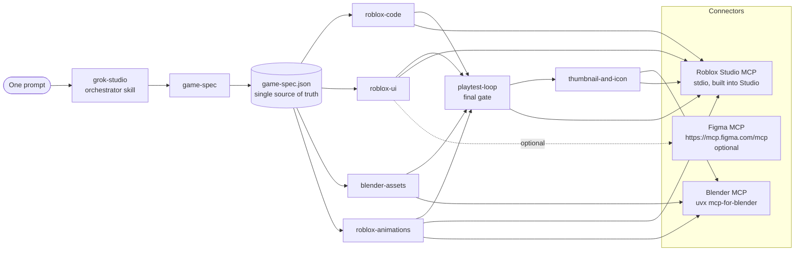
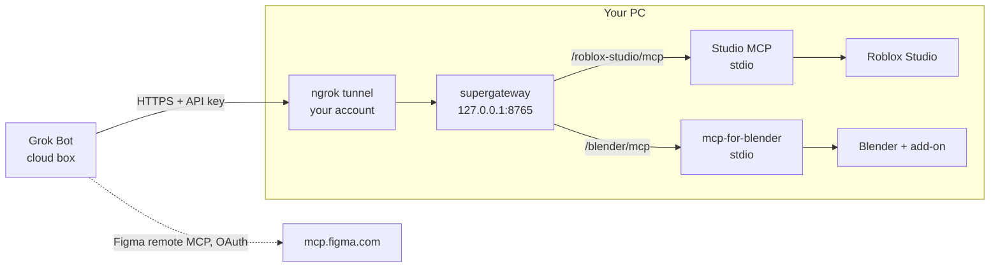

# grok-studio

**One prompt in, a playable Roblox game out.** `grok-studio` is an open-source agent
plugin that gives any AI coding agent an end-to-end workflow for building a complete Roblox
game: a structured game design spec, typed Luau code, mobile-ready UI, low-poly 3D models
and animations made in Blender, an automated playtest-and-fix loop, plus a thumbnail and
icon.

It works with **Cursor**, **Claude Code**, and **Grok Bot** (which installs plugins from the
Cursor marketplace), and drives three MCP connectors: the **Roblox Studio built-in MCP**,
**Blender MCP**, and (optionally) **Figma MCP**.

> Status: **v0.1.0, early draft.** The skills and configs follow the documented formats as of
> Oct 2026, but the full pipeline has not been run end-to-end against a live Studio yet.
> See [Limitations](#limitations).

---

## What's inside

```
.cursor-plugin/plugin.json   Cursor plugin manifest
.claude-plugin/plugin.json   Claude Code plugin manifest
mcp.json                     MCP servers for Cursor  (uses ${CURSOR_PLUGIN_ROOT})
.mcp.json                    MCP servers for Claude Code (uses ${CLAUDE_PLUGIN_ROOT}, typed http)
skills/
  grok-studio/            orchestrator: preflight, stage order, checkpoints, final gate
  game-spec/                 prompt -> game-spec.json (+ schema.json, example)
  roblox-code/               Luau architecture, remotes, DataStores, anti-exploit (+ reference/*.luau)
  roblox-ui/                 Figma path + Studio-direct ScreenGui builder (+ reference/UiKit.luau)
  blender-assets/            low-poly modeling, budgets, FBX export, import (+ reference/roblox_export.py)
  roblox-animations/         R15, Luau keyframes or Blender import, publish, wire
  playtest-loop/             start play, simulate input, read logs, fix, repeat, report
  thumbnail-and-icon/        512x512 icon, 1920x1080 thumbnails (+ reference/make_marketing_images.py)
rules/roblox-luau.mdc        Luau conventions (Cursor rule)
scripts/studio-mcp.mjs       cross-platform launcher for Studio's MCP server
scripts/validate.py          validates JSON + skill/rule frontmatter
bridge/                      start-bridge.ps1 / start-bridge.sh for remote agents
assets/logo.svg
```

## Architecture



**Local agents** (Cursor / Claude Code on the same PC as Studio) launch the stdio servers
directly. **Remote agents** (Grok Bot on a cloud Linux box) reach them through the bridge:



## Requirements

| Need | For | Notes |
|---|---|---|
| Roblox Studio (latest), Windows or macOS | everything | Enable **Assistant > ... > Manage MCP Servers > Enable Studio as MCP server** ([docs](https://create.roblox.com/docs/studio/mcp)) |
| Node.js LTS (`node`, `npx`) | Studio launcher, bridge | the plugin starts Studio MCP via `node scripts/studio-mcp.mjs` |
| uv (`uvx`) | Blender MCP, helper scripts | [install uv](https://docs.astral.sh/uv/getting-started/installation/) |
| Blender + MCP for Blender add-on | 3D models, animations, renders | optional; Studio generation is the fallback |
| Figma account (Professional+ seat to write) | UI design | optional; Studio-direct UI is the fallback |
| ngrok account | remote agents only | free tier works; any HTTPS tunnel works |

## Install

### A. Local agents (Cursor, Claude Code) - Studio on the same machine

1. **Get the plugin**
   - **Cursor:** once published, install **grok-studio** from the Cursor Marketplace
     (Customize). Until then, copy the folder (not a symlink - Cursor skips symlinks that
     point outside) into `~/.cursor/plugins/local/grok-studio`, then run **Developer:
     Reload Window** and check **Customize** for the skills and MCP servers
     ([docs](https://cursor.com/docs/plugins#test-plugins-locally)).
   - **Claude Code:** `claude --plugin-dir /path/to/grok-studio` for a session, or add it
     to a plugin marketplace you control. Claude Code reads `.claude-plugin/plugin.json`,
     `skills/`, and `.mcp.json` (it ignores `rules/*.mdc`; the conventions are repeated in
     the `roblox-code` skill).
2. **Roblox Studio:** open a place, enable *Studio as MCP server* (see above).
3. **Blender (optional):** `uvx mcp-for-blender setup` (installs/enables the add-on), open
   Blender; the add-on starts its server (N panel > MCP for Blender).
4. **Figma (optional):** the first Figma tool call opens an OAuth sign-in.
5. **Avoid duplicates:** if you previously used Studio's *Quick connect* or
   `mcp-for-blender setup` to add `Roblox_Studio`/`blender` to your client's own MCP config,
   either remove those entries or disable this plugin's copies in your client, so the agent
   doesn't see every tool twice. Same if you also installed Figma's own plugin.

GUI apps on macOS/Windows may not inherit your shell `PATH`. If `node` or `uvx` isn't
found, use full paths in your client's MCP settings (see the
[mcp-for-blender README](https://github.com/ahujasid/mcp-for-blender#make-your-client-find-uvx)).

### B. Remote agents (Grok Bot) - via the bridge

Grok Bot runs on a cloud Linux box, so it **cannot** launch stdio servers on your PC. The
plugin's `mcp.json` entries for Studio/Blender won't start there (the Studio launcher exits
with a message pointing here). Instead:

1. Install the plugin in Grok Bot from the Cursor Marketplace (skills + Figma connector).
2. On your PC (Studio + Blender open), run the bridge:
   ```powershell
   # Windows (PowerShell) - UNTESTED on Windows, please report issues
   powershell -ExecutionPolicy Bypass -File .\bridge\start-bridge.ps1 -Tunnel
   ```
   ```bash
   # macOS
   ./bridge/start-bridge.sh --tunnel
   ```
3. It prints two URLs (`.../roblox-studio/mcp`, `.../blender/mcp`) and an API key. In Grok
   Bot, add each as a **custom connector** (remote MCP, Streamable HTTP) with header
   `Authorization: Bearer <key>` (or `X-API-Key: <key>`).
4. Prompt the bot (see Quickstart). When done, **Ctrl+C** the bridge and remove the
   connectors.

Details, flags, and security notes: [`bridge/README.md`](bridge/README.md).

## Connector setup reference

### 1. Roblox Studio MCP (required)
- Built into Studio; local **stdio** process. Official configs
  ([docs](https://create.roblox.com/docs/studio/mcp)):
  - Windows: `cmd.exe /c %LOCALAPPDATA%\Roblox\mcp.bat`
  - macOS: `/Applications/RobloxStudio.app/Contents/MacOS/StudioMCP`
- Tools used: `list_roblox_studios`, `script_read`, `multi_edit`, `script_search`,
  `script_grep`, `execute_luau`, `search_game_tree`, `inspect_instance`, `search_asset`,
  `insert_asset`, `generate_mesh`, `generate_material`, `generate_procedural_model`,
  `get_studio_state`, `start_stop_play`, `get_console_output`, `screen_capture`,
  `character_navigation`, `user_keyboard_input`, `user_mouse_input`, `subagent`, `skill`.
  Every call takes a `studio_id`.

**How this plugin handles the OS difference.** A plugin `mcp.json` can't be OS-conditional,
so instead of asking every user to configure a path, the `roblox-studio` entry runs
`node ${CURSOR_PLUGIN_ROOT}/scripts/studio-mcp.mjs` (Claude Code: `${CLAUDE_PLUGIN_ROOT}`).
The launcher picks the right binary per OS, passes stdio straight through, and writes
diagnostics to stderr only. Override with the environment variable
`ROBLOX_STUDIO_MCP_PATH` for non-standard installs. We deliberately did **not** use a
Cursor plugin variable (`${ROBLOX_STUDIO_MCP_COMMAND}`): variables are set by admins in the
dashboard (Plugins > Configure), would force every user to configure something, and the
docs don't promise substitution inside `command`. Zero-config wins.

### 2. Blender MCP (optional, recommended)
- `uvx mcp-for-blender` (PyPI package formerly `blender-mcp`; `uvx blender-mcp` still
  works) - [github.com/ahujasid/mcp-for-blender](https://github.com/ahujasid/mcp-for-blender).
- Add-on: `uvx mcp-for-blender setup` or `uvx mcp-for-blender install-addon`, then enable
  **Interface: MCP for Blender** in Preferences > Add-ons.
- This plugin sets `BLENDER_MCP_SAFE_MODE=1`: scripts that touch arbitrary files, the
  network, or spawn processes are blocked; modeling, materials, rendering, saving, and
  import/export still work.
- **Alternative:** Blender's official [Blender Lab MCP server](https://www.blender.org/lab/mcp-server/)
  (Blender 5.1+, add-on from the Blender Lab repository). Its tool set differs; the
  `blender-assets` skill is written against mcp-for-blender but the bpy code it sends is
  portable. Blender Lab warns that it runs LLM-generated code without guards.

### 3. Figma MCP (optional)
- Remote server `https://mcp.figma.com/mcp`, OAuth on first use
  ([docs](https://developers.figma.com/docs/figma-mcp-server/remote-server-installation/)).
- Canvas writes (`use_figma`) are documented for Professional, Education, Organization and
  Enterprise plans (beta, free during beta). Read tools are rate-limited: View/Collab seats
  up to 20 calls/month; Full/Dev seats on Professional up to 200/day
  ([rate limits](https://developers.figma.com/docs/figma-mcp-server/rate-limits-access/)).
  On a Starter plan, expect to use the Studio-direct UI path.
- Figma also ships its own Cursor/Claude plugin with Figma skills; you can use that instead
  of this entry.

## Quickstart

1. Open Roblox Studio with a **new Baseplate** place (the agent edits the open place).
2. Make sure the connectors show up in your agent (Cursor: Customize; Claude Code: `/mcp`;
   Grok Bot: connectors list).
3. Prompt:

> Use the grok-studio skill to build a complete Roblox game: a co-op tycoon where
> players run a volcano-powered hot sauce factory. Conveyor droppers make sauce bottles,
> players collect cash, buy upgrades and unlock a second floor. Low-poly cartoon style,
> mobile-friendly UI, no monetization. Save progress. Make a thumbnail and icon.

The agent will: check connectors -> write and validate `game-spec.json` -> build scripts,
UI, assets, animations in Studio -> playtest until every acceptance test passes ->
produce `marketing/icon-512.png` and `marketing/thumb-*.png` -> hand you a short list of
manual steps (save, publish, enable API access for DataStores, upload images).

## Security

- **MCP servers here execute code.** Studio MCP runs Luau in your open places; Blender MCP
  runs Python in Blender. Only connect agents you trust, and work in a scratch place or
  keep a `.rbxl` backup.
- **Bridge:** anyone with the bridge URL + key can run code in Studio and Blender on your
  PC. A fresh 256-bit key per run, loopback-only binding, 401 without the key, Blender safe
  mode on, Ctrl+C tears everything down. Run it only during a build session.
- **Free models:** the skills inspect inserted Creator Store assets for suspicious scripts
  (`require(` by ID, `loadstring`, `getfenv`) - still review them.
- **API keys:** Open Cloud keys are only used from outside Roblox and never written into the
  place or this repo.
- The agent is instructed **not** to publish, change game settings, create products, or
  spend Robux without explicit permission.

## Limitations

- **Not yet run end-to-end against a live Studio session.** Tool names and behaviour follow
  Roblox's Studio MCP docs (Oct 2026); expect rough edges. Issues and PRs welcome.
- **Bridge scripts:** `start-bridge.ps1` is **untested on Windows** (it was syntax-checked
  with PowerShell 7). `start-bridge.sh` was smoke-tested on Linux with stand-in stdio
  servers (key enforcement and teardown verified), not on macOS with real Studio/Blender.
- Some steps still need human hands: importing FBX through Studio's Importer (unless you
  provide an Open Cloud API key), publishing animations, publishing the place, enabling
  Studio API access for DataStores, uploading the icon/thumbnails (no API-key endpoint
  documented for game media).
- Studio MCP screenshots are viewport-sized; for exact 1920x1080 thumbnails the Blender
  render path is preferred.
- "One-shot" scope is deliberately small (3-5 core mechanics). Bigger games need
  iteration.
- Grok Bot can't use the plugin's stdio entries; it needs the bridge.

## Roadmap

- [ ] End-to-end test runs on Windows (Zephyrus) and macOS; record a demo.
- [ ] Root `plugin.json` for the [Agent Plugins](https://agent-plugins.org) open standard.
      Not added in v0.1 because the standard's closed `mcp.json` requires `type` on every
      server, forbids placeholders in `command`, and uses `${PLUGIN_ROOT}` (which Cursor does
      not expand) - a shared file would conflict with the Cursor/Claude configs. Likely
      solution: generate a standards-conformant variant at publish time.
- [ ] Hooks: auto-run the require-check after script edits; block `publish` tool calls.
- [ ] Optional Rojo project template for file-based workflows.
- [ ] Open Cloud helpers: asset upload + polling script, place publishing with explicit
      consent.
- [ ] Blender Lab MCP compatibility notes per tool.
- [ ] Genre presets (obby, tycoon, simulator, round-based PvP) with tested spec templates.

## Validate locally

```bash
uv run --with pyyaml python scripts/validate.py    # JSON + frontmatter checks
uv run --with jsonschema python -c "import json,jsonschema;jsonschema.validate(json.load(open('skills/game-spec/example.game-spec.json')),json.load(open('skills/game-spec/schema.json')));print('ok')"
```

## Renaming

The working name `grok-studio` appears in `.cursor-plugin/plugin.json`,
`.claude-plugin/plugin.json`, the orchestrator skill folder/name, and this README. Search
and replace all four (keep it kebab-case).

## License

[MIT](LICENSE) (c) 2026 Anish Srinivasan. Not affiliated with or endorsed by Roblox
Corporation, the Blender Foundation, Figma, Cursor, Anthropic, or xAI. Roblox and Roblox
Studio are trademarks of Roblox Corporation.
