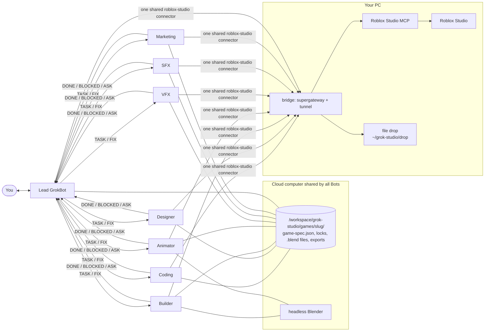

# grok-studio

**An agentic Roblox studio inside Grok Bot.** Install the plugin, run `/setup-bridge`, and describe your game to the Lead. You get a team of eight Grok Bots that build a complete Roblox game in *your* Roblox Studio from one prompt:

| Bot | Does |
|---|---|
| **Lead GrokBot** | talks to you, writes the game spec, plans and hands out tasks, runs playtests, final gate |
| **Coding GrokBot** | all Luau: server services, remotes with validation, DataStores, client controllers |
| **Designer GrokBot** | UI (HUD, menus, shops) in Studio, optional Figma |
| **Builder GrokBot** | the world and every 3D model, in Studio (parts, procedural and generated models) and in Blender |
| **Animator GrokBot** | rigs and animations (Luau keyframes in Studio, or Blender) |
| **VFX GrokBot** | particle effects, beams, trails, explosions, screen post-effects |
| **SFX GrokBot** | sound design via Creator Store, SoundGroups, mixing, spatial audio |
| **Marketing GrokBot** | icons, thumbnails, and post-ship X (Twitter) marketing drafts |

The Bots message each other directly, work in parallel, and share one cloud computer and
one `game-spec.json`. They follow a team protocol, so eight agents in one Studio don't
break each other's work.

---

## Install and Run

1. **Open Roblox Studio** on your PC: sign in, open or create a place, turn on **Team Create**
   (Home > Collaborate), and enable **Assistant > ... > Manage MCP Servers > Enable Studio as
   MCP server**.

2. **Install the plugin and run setup.** Paste this to any Grok Bot:
   ```
   Run curl -fsSL https://raw.githubusercontent.com/anishsrinivasa/grok-studio/main/scripts/bootstrap.sh | bash and do what it prints.
   ```

3. **Answer setup's few questions.** `/setup-bridge` does the rest:
   - installs the bridge on your PC as a background service (you approve the PC commands)
   - asks for keys in Grok Bot's secret prompt, never in chat: an ngrok authtoken and static
     domain, plus an optional Roblox Open Cloud API key for automatic model uploads
   - creates the team, one Bot per folder in `roles/` (eight by default), in a sidebar
     section named **Grok Studio** (create the section when asked; Bots can't)
   - installs headless Blender on the cloud computer
   - runs a readiness check (every Bot reaches Studio, a model round trip, a UI build, a
     5-second playtest) and shows a pass/fail table

   Running `/setup-bridge` again is safe and quick: it only repairs what's missing.

**Then describe your game to Lead GrokBot:**
> Make a co-op tycoon where players run a volcano-powered hot sauce factory. Conveyor
> droppers make sauce bottles, players collect cash, buy upgrades and unlock a second
> floor. Low-poly cartoon style, mobile-friendly UI, no monetization. Save progress.
> Make a thumbnail and icon.

**Afterwards:** every task starts with a health check. If anything breaks, message Lead GrokBot "reconnect Studio" or "run setup again".

## How it works



- **Studio** stays on your PC (it only runs on Windows/macOS). The bridge exposes it to
  the cloud Bots behind one authenticated, static URL (a background service with a stable key). See
  [`bridge/README.md`](bridge/README.md).
- **Blender** runs headless on the cloud computer. Models reach Studio through an Open Cloud
  upload (automatic, if you add a key) or one **Import 3D** click per batch, with the file
  already dropped on your PC.

## What setup connects

### Roblox Studio (required)
- Studio's built-in MCP server runs on your PC
  ([docs](https://create.roblox.com/docs/studio/mcp)): `%LOCALAPPDATA%\Roblox\mcp.bat` on
  Windows, `/Applications/RobloxStudio.app/Contents/MacOS/StudioMCP` on macOS. The bridge
  ([`bridge/`](bridge/README.md)) serves it to the Bots as one `roblox-studio` connector.
- Tools used: `list_roblox_studios`, `script_read`, `multi_edit`, `script_search`,
  `script_grep`, `execute_luau`, `search_game_tree`, `inspect_instance`, `search_asset`,
  `insert_asset`, `generate_mesh`, `generate_material`, `generate_procedural_model`,
  `get_studio_state`, `start_stop_play`, `get_console_output`, `screen_capture`,
  `character_navigation`, `user_keyboard_input`, `user_mouse_input`, `subagent`, `skill`.
  Every call takes a `studio_id`, which changes whenever Studio restarts, so every task
  looks it up with `list_roblox_studios`.

### Blender
- **Default:** headless Blender on the cloud computer
  (`skills/blender-assets/reference/cloud_blender.sh`), installed by setup. Nothing to
  install on your PC.
- **Optional, on your PC** (`/setup-bridge --pc-blender`): the bridge also serves
  [MCP for Blender](https://github.com/ahujasid/mcp-for-blender) (add-on:
  `uvx mcp-for-blender setup`) with `BLENDER_MCP_SAFE_MODE=1`: scripts that touch
  arbitrary files, the network, or spawn processes are blocked; modeling, materials,
  rendering, saving, and import/export still work.

### UI design (optional)
- Without a design tool, Designer GrokBot builds the UI directly in Studio.
- **Penpot** (free, open source): `skills/penpot-ui`.
- **Figma:** remote MCP server `https://mcp.figma.com/mcp`, OAuth on first use
  ([docs](https://developers.figma.com/docs/figma-mcp-server/remote-server-installation/)).
- Canvas writes (`use_figma`) are documented for Professional, Education, Organization and
  Enterprise plans (beta, free during beta). Read tools are rate-limited: View/Collab seats
  up to 20 calls/month; Full/Dev seats on Professional up to 200/day
  ([rate limits](https://developers.figma.com/docs/figma-mcp-server/rate-limits-access/)).
  On a Starter plan, expect to use the Studio-direct UI path.
